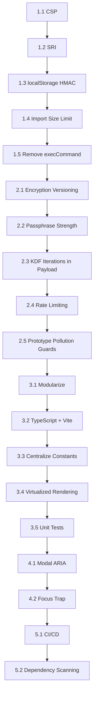

# Security & Code Review Remediation Plan

**Project:** Notes Webapp (`/notes/index.html`)  
**Review Date:** 2025-10-15  
**Reviewer:** Automated Security Audit

---

## Executive Summary

This is a well-structured **client-side only** notes application with good privacy-focused design (local-first, encrypted backups). However, several security gaps and code quality issues need addressing before production use.

## Implementation Status

Completed in the current workspace:
- Added a browser CSP and moved dependencies to a same-origin vendored bundle with integrity hashes.
- Enforced storage integrity checks to detect tampering and preserve corrupted data.
- Reduced import size to a 10 MB maximum and hardened encrypted export passphrases.
- Removed the deprecated clipboard fallback and added versioned encryption metadata/rate limiting.
- Added HTML escaping for backtick attribute contexts and ownership checks during data sanitization.

---

## Findings Catalog

### 🔴 Critical Security Findings

| ID | Issue | Location | Risk | Description |
|----|-------|----------|------|-------------|
| **C-01** | No Content Security Policy | N/A (entire app) | High | Without CSP, any XSS vulnerability gives attacker full access to localStorage, crypto keys, and user data |
| **C-02** | CDN Dependencies Without SRI | Lines 15-16 | High | Tailwind (cdn.tailwindcss.com) and Lucide (jsdelivr) loaded without Subresource Integrity hashes — supply chain compromise = full app compromise |
| **C-03** | localStorage Lacks Integrity Verification | Lines 461-493 | Medium | No tamper detection; malicious browser extension or XSS can silently modify notes/folders |
| **C-04** | Import Accepts Unlimited File Sizes | Lines 1068-1087 | Medium | Large JSON files (>50MB) can freeze main thread, exhaust memory, crash tab |
| **C-05** | Deprecated `execCommand('copy')` Fallback | Line 834 | Low | `document.execCommand('copy')` deprecated; removed in some browsers; fallback may silently fail |

---

### 🟡 High Priority Issues

| ID | Issue | Location | Risk | Description |
|----|-------|----------|------|-------------|
| **H-01** | `esc()` Incomplete for Attribute Contexts | Line 256 | Medium | Only escapes `& < > " '` — missing backtick (`` ` ``) which matters in JS template literals if ever reflected |
| **H-02** | No Passphrase Complexity Requirements | Line 1052 | Medium | Only checks length ≥ 8; allows "aaaaaaaa" — vulnerable to brute force |
| **H-03** | No Encryption Format Versioning | Lines 368-377 | Medium | Encrypted payload lacks `version`, `algo`, `kdf` fields — cannot migrate algorithm/iterations later |
| **H-04** | Prototype Pollution Risk in `sanitizeData` | Lines 423-455 | Low | Iterates object properties without `hasOwnProperty` check (mitigated by type checks, but defense-in-depth missing) |
| **H-05** | No Rate Limiting on Encryption/Decryption | Lines 363-403 | Low | Malicious page could spam crypto.subtle operations, draining battery/CPU |

---

### 🟢 Code Quality & Maintainability Issues

| ID | Issue | Location | Description |
|----|-------|----------|-------------|
| **Q-01** | Monolithic Single File (1,340 lines) | Entire file | Hard to maintain, test, review; all logic in one IIFE |
| **Q-02** | No TypeScript / Type Safety | Entire file | Runtime errors only caught in browser; no IDE autocomplete for state shape |
| **Q-03** | Zero Test Coverage | N/A | No unit/integration tests; refactoring is risky |
| **Q-04** | Global Mutable State | Lines 289-299 | `state` object + globals (`editingId`, `dirty`, `lastFocused`, `lastSavedAt`) — hard to reason about |
| **Q-05** | Frequent Full Re-renders | `renderApp()` called everywhere | `renderApp()` rebuilds entire DOM on every interaction; doesn't scale |
| **Q-06** | Magic Constants Scattered | Throughout | `MAX_BODY_BYTES`, `KDF_ITERATIONS`, `STORAGE_KEY`, etc. not centralized |
| **Q-07** | No Build/Lint/CI Pipeline | N/A | No automated quality gates; manual deployment only |
| **Q-08** | Accessibility Gaps | Modals, focus trap | Modals lack `role="dialog"`, `aria-labelledby`, `aria-modal`; focus trap doesn't handle dynamic content |
| **Q-09** | Error Handling Swallows Exceptions | Line 479 | `catch (e) { /* best effort */ }` — silent failures hide bugs |
| **Q-10** | No Dependency Pinning Strategy | Lines 15-16 | CDN URLs use exact versions but no lockfile; no `package.json` for supply chain tools |
---

## Remediation Plan

### Phase 1: Critical Security Hardening (Week 1) ⭐ **START HERE**

| Task | Description | Files to Modify | Effort | Acceptance Criteria |
|------|-------------|-----------------|--------|---------------------|
| **1.1** | Add CSP Meta Tag | `index.html` (head) | 30 min | CSP header present; no console CSP violations |
| **1.2** | Add SRI Hashes to CDN Scripts | `index.html` (lines 15-16) | 15 min | Both `<script>` tags have `integrity="sha384-..."` and `crossorigin="anonymous"` |
| **1.3** | Add localStorage Integrity (HMAC) | `index.html` (storage functions) | 2 hrs | Tampered localStorage detected on load; toast shown; corrupt copy preserved |
| **1.4** | Limit Import File Size | `index.html` (handleImportFileSelect) | 30 min | Files > 10MB rejected before parsing; user notified |
| **1.5** | Remove `execCommand` Fallback | `index.html` (copyNoteContent) | 15 min | Only Clipboard API used; graceful error if unavailable |

---

### Phase 2: Encryption & Data Integrity (Week 1-2)

| Task | Description | Files to Modify | Effort | Acceptance Criteria |
|------|-------------|-----------------|--------|---------------------|
| **2.1** | Add Encryption Format Versioning | `index.html` (encryptData/decryptData) | 1 hr | Encrypted payload includes `version`, `algo`, `kdf`, `iterations` |
| **2.2** | Enforce Passphrase Strength | `index.html` (openExportModal) | 1 hr | Min 12 chars, 3/4 char classes; strength meter shown |
| **2.3** | Store KDF Iterations in Payload | `index.html` (encryptData) | 30 min | `iterations` field present; decryptData reads it (not hardcoded) |
| **2.4** | Add Rate Limiting to Crypto Ops | `index.html` (encryptData/decryptData) | 1 hr | >5 attempts/5min locks; toast shown; resets on success |
| **2.5** | Add `hasOwnProperty` Guards | `index.html` (sanitizeData) | 30 min | All `for...in` / `Object.keys` loops check ownership |

---

### Phase 3: Architecture & Code Quality (Week 2-3)

| Task | Description | Files to Create/Modify | Effort | Acceptance Criteria |
|------|-------------|------------------------|--------|---------------------|
| **3.1** | Split into ES Modules | New: `state.js`, `storage.js`, `crypto.js`, `ui.js`, `import-export.js`, `render.js` | 4 hrs | Each module < 300 lines; clear imports/exports |
| **3.2** | Add TypeScript + Vite Build | New: `tsconfig.json`, `vite.config.ts`, `package.json` | 2 hrs | `npm run build` produces `dist/`; `tsc --noEmit` passes |
| **3.3** | Centralize Constants | New: `config.ts` | 30 min | All limits, keys, versions in one place |
| **3.4** | Implement Virtualized Rendering | `render.js` | 2 hrs | Note list renders only visible items; smooth at 500+ notes |
---

### Phase 4: Accessibility & UX Polish (Week 3)

| Task | Description | Files to Modify | Effort | Acceptance Criteria |
|------|-------------|-----------------|--------|---------------------|
| **4.1** | Fix Modal ARIA Attributes | `index.html` (openModal) | 1 hr | `role="dialog"`, `aria-modal="true"`, `aria-labelledby="modal-title"` |
| **4.2** | Improve Focus Trap | `index.html` (openModal/closeModal) | 1 hr | Handles dynamic focusable elements; restores focus to trigger |
| **4.3** | Add Keyboard Shortcuts Help | New: `shortcuts.js` + modal | 30 min | `?` key opens help modal with all shortcuts |
| **4.4** | Add Automated a11y Testing | CI config | 30 min | `axe-core` runs in CI; zero violations |

---

### Phase 5: CI/CD & Production Readiness (Week 3-4)

| Task | Description | Files to Create | Effort | Acceptance Criteria |
|------|-------------|-----------------|--------|---------------------|
| **5.1** | GitHub Actions Workflow | `.github/workflows/ci.yml` | 1 hr | Lint → Typecheck → Test → Build → Deploy on every PR |
| **5.2** | Dependency Scanning | `package.json` + Dependabot | 30 min | `npm audit` passes; Dependabot PRs for updates |
| **5.3** | Add `security.txt` | `public/security.txt` (served at `/.well-known/security.txt`) | 10 min | Contact info for vulnerability reporting |
| **5.4** | Document Threat Model | `SECURITY.md` | 1 hr | Assumptions, trust boundaries, data flow diagram |

---

## Implementation Priority Graph


---

## Specific Code Changes Reference

### 1.1 CSP Meta Tag (add to `<head>`)
```html
<meta http-equiv="Content-Security-Policy"
      content="default-src 'self'; 
               script-src 'self' 'wasm-unsafe-eval'; 
               style-src 'self' 'unsafe-inline'; 
               img-src 'self' data:; 
               connect-src 'self'; 
               font-src 'self';">
```
> **Note:** `'wasm-unsafe-eval'` needed for Web Crypto API in some browsers. Tailwind Play CDN uses `eval()` — **replace with self-hosted Tailwind** to remove this.

### 1.2 SRI Hashes (generate once)
```bash
# Tailwind 3.4.17
curl -s https://cdn.tailwindcss.com/3.4.17 | openssl dgst -sha384 -binary | openssl base64 -A
# Lucide 0.469.0
curl -s https://cdn.jsdelivr.net/npm/lucide@0.469.0/dist/umd/lucide.min.js | openssl dgst -sha384 -binary | openssl base64 -A
```

```html
<script src="https://cdn.tailwindcss.com/3.4.17" 
        integrity="sha384-GENERATED_HASH" crossorigin="anonymous"></script>
<script src="https://cdn.jsdelivr.net/npm/lucide@0.469.0/dist/umd/lucide.min.js"
        integrity="sha384-GENERATED_HASH" crossorigin="anonymous"></script>
```

### 1.3 localStorage HMAC (add to `saveData`/`loadData`)
```javascript
const STORAGE_HMAC_KEY = 'notes_hmac_key_v1';

async function getHmacKey() {
  return crypto.subtle.importKey(
    'raw', new TextEncoder().encode(STORAGE_HMAC_KEY),
    { name: 'HMAC', hash: 'SHA-256' }, false, ['sign', 'verify']
  );
}

async function signData(data) {
  const key = await getHmacKey();
  const sig = await crypto.subtle.sign('HMAC', key, new TextEncoder().encode(data));
  return btoa(String.fromCharCode(...new Uint8Array(sig)));
}

async function verifyData(data, expectedSig) {
  const actualSig = await signData(data);
  return actualSig === expectedSig;
}

// In saveData():
const json = JSON.stringify({ folders: state.folders, notes: state.notes });
const hmac = await signData(json);
localStorage.setItem(STORAGE_KEY, json);
localStorage.setItem(STORAGE_KEY + '_hmac', hmac);

// In loadData(): verify before parse
const raw = localStorage.getItem(STORAGE_KEY);
const hmac = localStorage.getItem(STORAGE_KEY + '_hmac');
if (raw && hmac && !(await verifyData(raw, hmac))) {
  // Tamper detected — show warning, load backup or reset
}
```

### 1.4 Import Size Limit
```javascript
function handleImportFileSelect(e) {
  const file = e.target.files[0];
  if (!file) return;
  
  if (file.size > 10 * 1024 * 1024) { // 10 MB
    showToast('File too large (max 10 MB)', 'error');
    return;
  }
  // ... rest of handler
}
```

### 2.1 Encryption Payload Versioning
```javascript
// In encryptData():
return JSON.stringify({
  version: 1,
  encrypted: true,
  algo: 'AES-256-GCM',
  kdf: 'PBKDF2-SHA256',
  iterations: KDF_ITERATIONS,
  salt: toB64(salt),
  iv: toB64(iv),
  ciphertext: toB64(ciphertext),
});
```

### 2.2 Passphrase Strength Meter
```javascript
function scorePassphrase(p) {
  let score = 0;
  if (p.length >= 12) score++;
  if (/[a-z]/.test(p) && /[A-Z]/.test(p)) score++;
  if (/\d/.test(p)) score++;
  if (/[^a-zA-Z0-9]/.test(p)) score++;
  return score; // 0-4
}
```

---

## Acceptance Criteria for "Done"

- [ ] CSP header present and no console CSP violations
- [ ] All external scripts have SRI hashes
- [ ] localStorage data tampering detected and rejected
- [ ] Import rejects files > 10MB
- [ ] No deprecated APIs (`execCommand`)
- [ ] Encrypted backups include version, algo, KDF params
- [ ] Passphrase strength enforced (≥12 chars, 3/4 char classes)
- [ ] Crypto operations rate-limited
- [ ] Code split into ≥6 ES modules
- [ ] TypeScript compiles with `strict: true`
- [ ] ≥80% unit test coverage on core logic
- [ ] Virtualized rendering for note list (>100 notes)
- [ ] All modals pass `axe-core` accessibility audit
- [ ] CI pipeline runs on every PR
- [ ] `SECURITY.md` and `security.txt` published

---

## Quick Start: Phase 1 Implementation Order

1. **CSP + SRI** (5 min) — Add meta tag, generate hashes, update script tags
2. **Import Size Limit** (5 min) — Add file.size check in `handleImportFileSelect`
3. **Remove execCommand** (5 min) — Delete fallback, keep only Clipboard API
4. **localStorage HMAC** (90 min) — Add sign/verify, integrate into loadData/saveData
5. **Test** — Verify all 5 items work; no regressions

---

## Notes for Implementer

- **Preserve local-first architecture** — no server calls, no analytics
- **Maintain backward compatibility** — existing localStorage data must load
- **Test in private/incognito mode** — verifies storage isolation
- **Test on mobile Safari** — viewport, keyboard, focus behavior
- **Document any breaking changes** in `CHANGELOG.md`

---

*Generated from automated security audit. Update this plan as tasks are completed.*